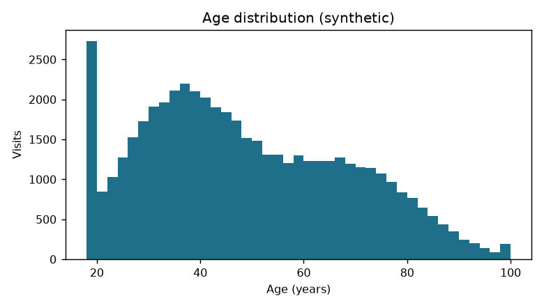
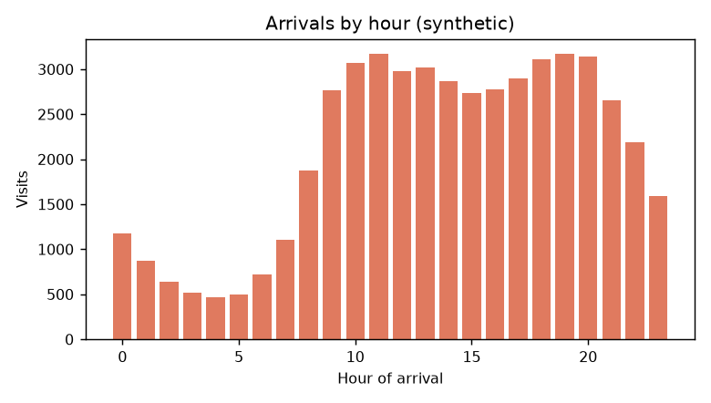
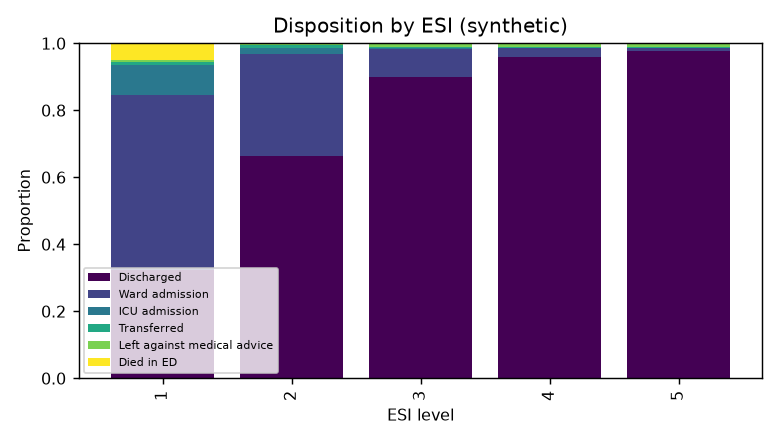
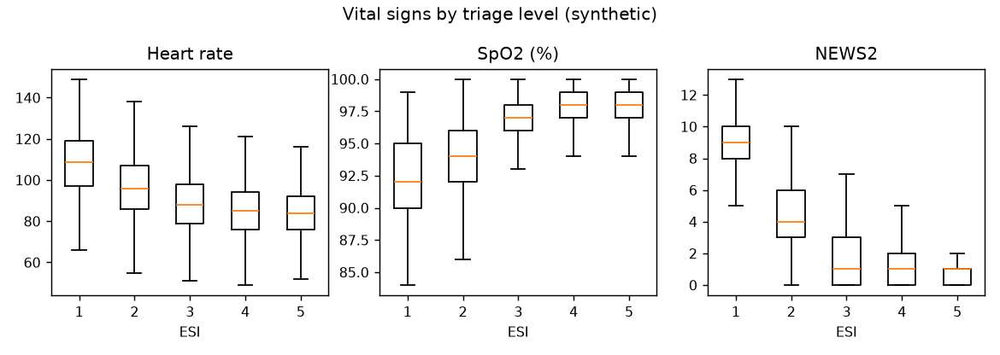

# Validation report — Turkish ED Synthetic Cohort

> **Fully synthetic data.** These summaries describe the *generator output*, not any real hospital. Statistics below were computed on the **full 50,000-row cohort**; this public repository contains a seeded random 5,000-row sample.

Full cohort: **50,000** rows · Public sample: **5,000** rows · Columns: **45**

## 1. Demographics

- Age: mean 48.4, median 45, IQR 33–63, range 18–100
- Female: 51.2% · Ambulance arrival: 11.4%

## 2. Triage

| ESI | % |
|---|---|
| 1 | 1.9% |
| 2 | 14.3% |
| 3 | 28.8% |
| 4 | 32.2% |
| 5 | 22.8% |

ESI × Turkish colour triage (row %):

|   esi_level | Kırmızı   | Sarı   | Yeşil   |
|------------:|:----------|:-------|:--------|
|           1 | 100%      | 0%     | 0%      |
|           2 | 2%        | 98%    | 0%      |
|           3 | 0%        | 94%    | 6%      |
|           4 | 0%        | 0%     | 100%    |
|           5 | 0%        | 0%     | 100%    |

## 3. Disposition and outcomes

| Disposition | % |
|---|---|
| Discharged | 89.17% |
| Ward admission | 8.87% |
| Left against medical advice | 1.01% |
| ICU admission | 0.51% |
| Transferred | 0.32% |
| Died in ED | 0.11% |

- 30-day mortality: 0.80%
- ED length of stay (min): median 164, IQR 107–255
- Hospital LOS among admitted (days): median 5

Admission rate by ESI: ESI 1: 61.2%, ESI 2: 32.4%, ESI 3: 8.7%, ESI 4: 2.8%, ESI 5: 0.8%

## 4. Vital signs and laboratory values

|                    |   count |   mean |     5% |    50% |    95% |   missing_% |
|:-------------------|--------:|-------:|-------:|-------:|-------:|------------:|
| sbp_mmhg           |   48589 | 130.41 |  97    | 130    | 170    |        2.82 |
| dbp_mmhg           |   48589 |  79.31 |  58    |  80    | 105    |        2.82 |
| heart_rate_bpm     |   48527 |  88.13 |  65    |  87    | 114    |        2.95 |
| resp_rate_min      |   47594 |  18.03 |  14    |  18    |  24    |        4.81 |
| temperature_c      |   48088 |  36.87 |  36.2  |  36.8  |  37.9  |        3.82 |
| spo2_pct           |   48592 |  96.79 |  92    |  97    | 100    |        2.82 |
| gcs                |   50000 |  14.89 |  14    |  15    |  15    |        0    |
| wbc_10e9_l         |   33855 |   8.99 |   5.2  |   8.4  |  14.3  |       32.29 |
| hgb_g_dl           |   33855 |  13.03 |  10.4  |  13    |  15.6  |       32.29 |
| plt_10e9_l         |   33855 | 259.12 | 157    | 250    | 394    |       32.29 |
| creatinine_mg_dl   |   33855 |   1.03 |   0.65 |   0.93 |   1.61 |       32.29 |
| glucose_mg_dl      |   33855 | 132.15 |  81    | 118    | 212    |       32.29 |
| sodium_mmol_l      |   33855 | 138.66 | 134    | 139    | 143    |       32.29 |
| potassium_mmol_l   |   33855 |   4.21 |   3.6  |   4.2  |   4.9  |       32.29 |
| crp_mg_l           |   13779 |  21.41 |   1.4  |   6.9  |  70.1  |       72.44 |
| lactate_mmol_l     |    7393 |   2.14 |   1    |   1.7  |   4    |       85.21 |
| hs_troponin_i_ng_l |   12011 | 112.45 |   2    |   6    |  50    |       75.98 |
| news2              |   42223 |   1.9  |   0    |   1    |   7    |       15.55 |
| shock_index        |   47221 |   0.7  |   0.45 |   0.68 |   1.01 |        5.56 |

Laboratory values are missing **by design** when the test would not plausibly have been ordered (e.g. no labs for an ankle sprain); vital signs have a small MAR missingness that is higher for low-acuity and night-time visits.

## 5. Built-in clinical associations (sanity checks)

|                |   age |   news2 |   esi_level |   heart_rate_bpm |   spo2_pct |   lactate_mmol_l |   ed_los_min |
|:---------------|------:|--------:|------------:|-----------------:|-----------:|-----------------:|-------------:|
| age            |  1    |    0.04 |       -0.39 |             0.02 |      -0.31 |             0.06 |         0.11 |
| news2          |  0.04 |    1    |       -0.51 |             0.48 |      -0.39 |             0.17 |         0.1  |
| esi_level      | -0.39 |   -0.51 |        1    |            -0.26 |       0.42 |            -0.27 |        -0.16 |
| heart_rate_bpm |  0.02 |    0.48 |       -0.26 |             1    |      -0.13 |             0.17 |         0.06 |
| spo2_pct       | -0.31 |   -0.39 |        0.42 |            -0.13 |       1    |             0.01 |        -0.11 |
| lactate_mmol_l |  0.06 |    0.17 |       -0.27 |             0.17 |       0.01 |             1    |         0.08 |
| ed_los_min     |  0.11 |    0.1  |       -0.16 |             0.06 |      -0.11 |             0.08 |         1    |

- Median hs-troponin I: myocardial infarction 57 ng/L vs unspecified chest pain 5 ng/L
- Sepsis: median lactate 4.0 mmol/L, qSOFA ≥2 in 76%, 30-day mortality 10%

## 6. Learnability check (admission prediction)

A plain logistic regression on age, ESI, NEWS2, HR, SpO2 and SBP predicts admission with held-out **AUC = 0.852**. This only shows that the data contain learnable, clinically directed signal; it is not a benchmark and says nothing about real-world model performance.

## 7. Figures

